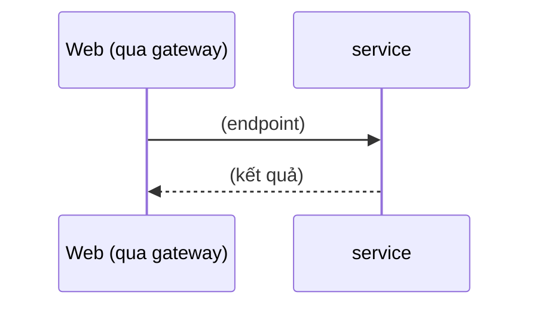

# Service `execution`

Thẻ của service: AI và người đọc tệp này trước khi sửa mã. Chủ service cập nhật nó **trong cùng
commit** với mã theo luật ở mục 4 của `CLAUDE.md` (CI `pnpm check:docs` nhắc khi quên). Mẫu này nằm
trong khuôn; `scripts/new-service.sh` điền tên.

## Thông tin

| | |
| --- | --- |
| Chủ | TV4 (điền tên, tài khoản GitHub) |
| Cổng mặc định | 3005 (`bootstrapService({ port: 3005 })`; trong compose là 3000) |
| Database | `execution` (tài khoản `execution`, `infra/postgres-init.sql`), `PG_SCHEMA=execution` |
| Gọi qua gateway | `/api/v1/executions`, `/api/v1/milestones`, `/api/v1/tasks`, `/api/v1/disputes`, `/api/v1/exceptions`, `/api/v1/contract-imports` (`gateway/routes.json` của repo cha) |
| Thẻ nhiệm vụ | `docs/nhiem-vu/TV4.md` |

## Sơ đồ mã

Mỗi tệp trong `service/src` một dòng: làm gì. AI đọc bảng này thay vì mở từng tệp.

| Tệp | Làm gì |
| --- | --- |
| `main.ts` | Khởi động: `bootstrapService({ module, name, port })` |

## Sơ đồ luồng

Luồng chính của service (Mermaid). Sửa khi đổi luồng, thêm lời gọi sang service khác hoặc sự kiện.

## Dữ liệu sở hữu

Chỉ service này ghi các bảng (collection) dưới đây; service khác hỏi qua API hoặc sự kiện.

| Collection | Ý nghĩa | Khai báo trong `packages/contracts/resources.json`? |
| --- | --- | --- |
| parties | Bản sao chỉ đọc của các bên (mã theo identity) | chưa |
| contracts | Ảnh chụp bất biến của hợp đồng đã ký (gói v1) | chưa |
| milestones | Mốc đang thực hiện và trạng thái | chưa |
| events | Dòng sự kiện của mốc: chứng từ, phê duyệt, từ chối, tranh chấp | chưa |
| status-history | Lịch sử trạng thái mốc | chưa |
| amendments | Phụ lục | chưa |
| exceptions | Ngoại lệ | chưa |
| notes | Ghi chú | chưa |

Bản dự kiến theo `docs/PHAN_TICH_THIET_KE.md` §3; chủ service sửa khi chốt.

## Endpoint

Chi tiết ở `service/openapi.yaml`. Mỗi endpoint có ít nhất một lỗi nghiệp vụ 4xx kèm mã.

| Phương thức, đường dẫn | Quyền | Lỗi nghiệp vụ |
| --- | --- | --- |
| `POST /contract-imports` | service signing (sự kiện), quản trị | 409 `ALREADY_IMPORTED`, 422 `PACKAGE_INVALID` |
| `GET /executions, GET /executions/{contractId}` | thành viên | 404 |
| `GET /milestones/{id}` | thành viên | 404 |
| `POST /milestones/{id}/evidence` | bên có thẩm quyền | 403 `NOT_AUTHORIZED_PARTY`, 409 `DUPLICATE_EVIDENCE`, `MILESTONE_LOCKED`, 422 `INVOICE_AMOUNT_MISMATCH` |
| `POST /milestones/{id}/approvals, /rejections` | vai trò duyệt | 409 `ALREADY_APPROVED_BY_ROLE`, 403 `ROLE_NOT_REQUIRED` |
| `POST /milestones/{id}/disputes, POST /disputes/{id}/resolution` | theo bên | 409 `DISPUTE_ALREADY_OPEN`, 403 |
| `POST /milestones/{id}/exceptions, POST /exceptions/{id}/decision` | chủ hợp đồng, kiểm soát viên | 409 `SELF_APPROVAL_FORBIDDEN` |
| `GET /tasks` | đã đăng nhập |  |

Bản dự kiến theo `docs/PHAN_TICH_THIET_KE.md` §6 (chưa làm); `openapi.yaml` là bản chi tiết.

## Sự kiện

| Phát | Nhận |
| --- | --- |

## Nguồn CodeCash

Tệp trong `../codecash` chuyển vào service này (xem `docs/DOI_CHIEU_CODECASH.md`), và đã chuyển chưa.

| Tệp cũ | Sang | Trạng thái |
| --- | --- | --- |

## Rà soát nghiệp vụ

Chỗ mã cũ lệch, thiếu so với `../codecash/docs/NGHIEP_VU.md`, và đã xử lý thế nào.

## Cải tiến so với CodeCash

Những gì làm khác hoặc tốt hơn bản cũ, và vì sao (dùng cho báo cáo).
